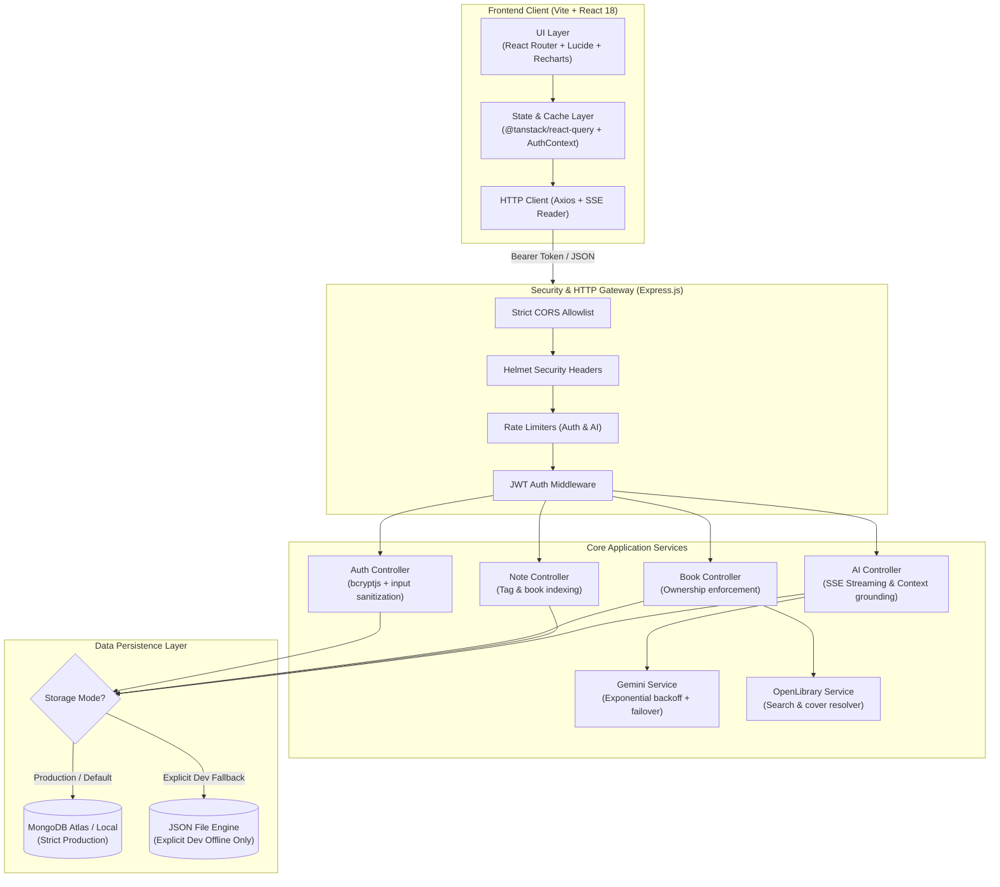
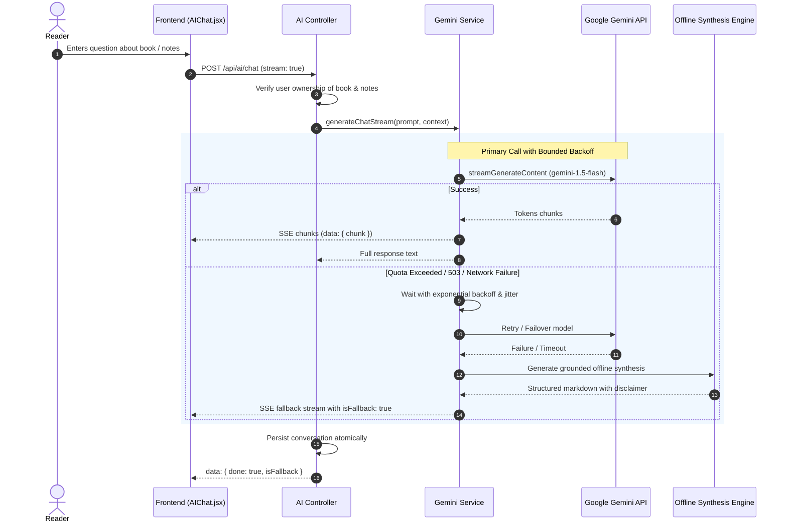

# 📚 BookMind AI

> **Intelligent Personal Reading Library, Knowledge Synthesizer & AI Reading Assistant**  
> Built with modern full-stack MERN architecture and hardened for enterprise reliability, security, and performance.

[](https://nodejs.org/)
[](https://react.dev/)
[](https://expressjs.com/)
[](https://www.mongodb.com/)
[](https://aistudio.google.com/)
[](file:///d:/BookMind%20AI/server/tests)
[](file:///d:/BookMind%20AI/docs/ARCHITECTURE.md)

---

## 📌 Executive Overview & Problem Statement

Avid readers and lifelong learners frequently struggle with **retention, note fragmentation, and disconnected insights**. While existing cataloging tools (e.g., Goodreads) track what you read, they fail to synthesize personal reflections or facilitate active recall.

**BookMind AI** solves this problem by combining:
1. **Personal Digital Library Management**: Track reading status, progress percentage, annual targets, and ratings.
2. **Context-Grounding Note Workspace**: Capture chapter reflections, quotes, and concepts connected directly to specific books or tags.
3. **AI Reading Companion**: Ask natural-language questions about saved books, synthesize takeaways across personal notes, and discover high-signal connections using Google Gemini.
4. **Deterministic Failover & Offline Engine**: When external AI services experience quota limits or service interruptions, BookMind AI automatically falls back to an offline synthesis engine, ensuring zero user disruption.

*Live Web Application:* [https://book-m-ind-ai.vercel.app](https://book-m-ind-ai-five.vercel.app/) *(Production deployment — verify hosted backend health via `/api/health`)*

---

## 🏗️ Architecture & Request Lifecycle



---

## 🛠️ Technology Stack & Role Alignment

| Layer | Technologies Used | Implementation Rationale |
| :--- | :--- | :--- |
| **Frontend** | React 18, Vite, React Router 6, TanStack Query, Recharts, Lucide React, Vanilla CSS | Rapid client-side routing, code-splitting via `React.lazy`, optimistic caching, and rich responsive aesthetics. |
| **Backend API** | Node.js (v18–v24), Express.js, Helmet, Express Rate Limit, CORS | Lightweight, non-blocking asynchronous event loop, microsecond I/O handling, and modular routing. |
| **Database** | MongoDB Atlas, Mongoose 8 (with isolated JSON Dev Engine) | Document-oriented schema suited for multi-genre arrays, variable-length notes, and compound TTL cache indexes. |
| **AI Integration** | Google Gemini Generative AI SDK (`@google/generative-ai`), SSE Streaming | Real-time token streaming (`text/event-stream`), bounded exponential backoff with jitter, and smart fallback responses. |
| **External APIs** | OpenLibrary Search API & Covers Engine | Instant bibliographic lookups with rate-limiting tolerance and automated cover resolution. |
| **Testing** | Node.js Built-in Test Runner (`node:test`), Node Assert, Supertest | Zero-dependency, ultra-fast test suite running 33 automated tests in ~2.5 seconds. |

> **Alignment Note for 75WAY Hiring Round:**  
> This project represents a production-grade full-stack MERN + AI implementation. While the job posting notes general multi-stack versatility (e.g., Python, TypeScript, .NET, mobile), this repository intentionally focuses on **deep architectural excellence, OWASP security hardening, bulletproof resource isolation, and test-driven reliability** within modern JavaScript/React/Node.js.

---

## 🔒 Security Audit & Hardening (Phase 1 Implemented)

1. **Zero Committed Secrets**:
   - `server/.env` and `server/data/` untracked from Git tracking index.
   - Comprehensive `.gitignore` ignores all `.env*` files, local stores, and dependency trees.
2. **Eliminated Hardcoded Fallbacks**:
   - Insecure fallback JWT secrets removed. Missing `JWT_SECRET` in production causes a safe, immediate startup failure.
3. **OWASP Input Validation & Sanitization**:
   - RFC-compliant email normalization (`.toLowerCase().trim()`) prevents account duplication and bypass attacks.
   - Password bounds (6–128 chars), name limits (max 100 chars), reading goal bounds (1–1000).
   - Reading status strictly validated against allowed enums (`want_to_read`, `currently_reading`, `completed`).
   - Progress pages bounded (`0 <= progressPages <= totalPages`).
4. **Strict Multi-Tenant Resource Ownership**:
   - User B cannot view, modify, delete, or attach notes to User A's books (validated by automated test suites returning `403 Forbidden` / `404 Not Found`).
5. **Transport Security & Headers**:
   - Helmet security headers applied.
   - Strict CORS policy replaces wildcard configurations with an explicit allowlist from `CLIENT_URL`.
   - Rate limiting applied to `/api/auth` (100 req / 15 min) and `/api/ai` (30 req / 1 min).
   - Payload size bounded to `1mb` to prevent memory exhaustion (DoS).

---

## 💾 Storage Engine: Explicit Modes (Phase 2 Implemented)

BookMind AI features a dual-engine repository abstraction (`BookRepo`, `NoteRepo`, `UserRepo`, `ChatRepo`, `RecommendationRepo`):

- **Production Mode (`NODE_ENV=production`)**:
  - **MongoDB is mandatory**.
  - Silent fallback to local JSON is **strictly forbidden** (prevents data loss across container/serverless restarts). If `MONGO_URI` is missing or connection fails, the server fails startup fast with a descriptive fatal error.
- **Development Mode (`NODE_ENV=development`)**:
  - Automatically connects to MongoDB if `MONGO_URI` is reachable.
  - If MongoDB is offline or `STORAGE_MODE=json` is set, clearly logs dev fallback to local file store in safe startup banners.
- **Health & Readiness Endpoints**:
  - `GET /api/health`: Returns service health, uptime, and active storage engine.
  - `GET /api/ready`: Returns `503 Service Unavailable` if MongoDB is down in production; returns `200 OK` when ready for traffic.

---

## 🤖 AI Resilience & Failover Architecture (Phase 3 Implemented)



- **Verified Model Identifiers**: Defaults to `gemini-1.5-flash` with failover to `gemini-1.5-pro` (invalid model IDs like `gemini-3.6-flash` are handled gracefully).
- **Distinguishable Responses**: Offline fallback responses are clearly watermarked with `> Note: Response generated by BookMind Offline Synthesis Engine` so users and recruiters are never misled.
- **Client Disconnect Handling**: If the user navigates away mid-stream, the connection is cleanly closed without hanging server resources.

---

## 📁 Repository Directory Structure

```text
BookMind AI/
├── client/                     # React 18 + Vite Frontend
│   ├── src/
│   │   ├── components/         # Reusable UI, Books, Notes, and AI components
│   │   │   ├── ai/             # AIChat (SSE streaming) & ContextualBookAIPanel
│   │   │   ├── books/          # BookCard, BookCover (gradient fallbacks), BookSearchModal
│   │   │   ├── layout/         # AppShell, Sidebar, Topbar, MobileNav
│   │   │   ├── notes/          # NoteCard, NoteEditorModal
│   │   │   └── ui/             # Button, Input, Modal, Badge, ProgressBar, Skeleton
│   │   ├── context/            # AuthContext, ThemeContext, ToastContext
│   │   ├── pages/              # Dashboard, Library, BookDetails, Notes, Recommendations, AI
│   │   ├── styles/             # Curated design system (variables.css, index.css)
│   │   ├── App.jsx             # Code-split client routes & protected wrappers
│   │   └── main.jsx            # Entry point & TanStack Query client setup
│   ├── package.json
│   └── vite.config.js          # Vite config with /api development proxy
│
├── server/                     # Node.js + Express REST Backend
│   ├── src/
│   │   ├── config/             # Database connection, storage mode, and JSON store
│   │   ├── controllers/        # Auth, Book, Note, and AI business logic
│   │   ├── middleware/         # JWT verification & authorization
│   │   ├── models/             # Mongoose schemas + Repository abstraction (Mongo & JSON)
│   │   ├── routes/             # REST route definitions
│   │   ├── services/           # Gemini AI Service & OpenLibrary API Service
│   │   └── index.js            # Express server entry point, CORS, and Helmet configuration
│   ├── tests/                  # Automated test suite (Supertest + node:test)
│   │   ├── auth.test.js        # Registration, login, validation, password security
│   │   ├── resource_isolation.test.js # Multi-tenant isolation & ownership tests
│   │   ├── ai_and_external.test.js    # Gemini failover & OpenLibrary tests
│   │   └── health.test.js      # Health and readiness check tests
│   ├── package.json
│   └── .env.example            # Backend environment template
│
├── docs/                       # Technical Submission Documentation
│   ├── ARCHITECTURE.md         # Detailed architectural documentation
│   ├── API.md                  # Complete REST API reference
│   └── DEMO_SCRIPT.md          # 2-3 minute interview walkthrough & technical Q&A
├── package.json                # Root orchestration package
├── .gitignore                  # Git tracking rules
└── README.md                   # Project overview & evaluation guide
```

---

## 🚀 Local Development Setup

### 1. Prerequisites
- **Node.js**: v18.0.0 or higher (v20+ recommended; verified on v24)
- **npm**: v9.0.0 or higher
- **MongoDB** *(Optional for local dev)*: Local MongoDB instance or MongoDB Atlas connection string. If omitted in dev, BookMind runs in explicit JSON development mode.

### 2. Installation
Clone the repository and install dependencies across root, server, and client:

```bash
# Clone repository
git clone https://github.com/sainidivyansh2517/BookMInd-AI.git
cd BookMInd-AI

# Install all workspace dependencies
npm run install:all
```

### 3. Environment Configuration
Create local `.env` files using the provided templates:

**Backend (`server/.env`):**
```bash
cp server/.env.example server/.env
```
Fill in your local configuration:
```env
PORT=5000
NODE_ENV=development
STORAGE_MODE=mongodb
JWT_SECRET=generate_a_random_32_byte_string_here
MONGO_URI=mongodb+srv://<username>:<password>@cluster0.mongodb.net/bookmind?retryWrites=true&w=majority
GEMINI_API_KEY=your_gemini_api_key_from_google_ai_studio
GEMINI_MODEL=gemini-1.5-flash
CLIENT_URL=http://localhost:3000
```
*(Tip: Set `STORAGE_MODE=json` if you want to run locally without a MongoDB connection).*

**Frontend (`client/.env`):**
```bash
cp client/.env.example client/.env
```
*(Leave `VITE_API_URL` blank in development to leverage the built-in Vite proxy to `http://localhost:5000`).*

### 4. Running the Application

In separate terminal windows (PowerShell / Bash):

```bash
# Terminal 1: Start Backend API (Port 5000)
npm run dev:server

# Terminal 2: Start Frontend Client (Port 3000)
npm run dev:client
```
Open [http://localhost:3000](http://localhost:3000) in your browser.

---

## 🧪 Automated Testing & Verification

BookMind AI includes a comprehensive test suite covering authentication, resource isolation, data validation, AI fallback, and system health:

```bash
# Execute backend test suite
npm test
```

### Test Suite Summary:
```text
✔ AI Assistant & External Services Integration (7 tests)
✔ Authentication and User Profile Management (11 tests)
✔ Health and System Status Endpoints (3 tests)
✔ Resource Ownership, Isolation & Data Validation (12 tests)

ℹ tests: 33 passed | 0 failed
ℹ duration: ~2.5 seconds
```

### Frontend Build Verification:
```bash
# Verify client production bundle
npm run build:client
```
Result: Builds production bundle into `client/dist/` in < 4 seconds with zero lint/bundler errors.

---

## 📡 REST API Reference

| Method | Endpoint | Auth | Description |
| :--- | :--- | :---: | :--- |
| `POST` | `/api/auth/register` | No | Register new user account with hashed password |
| `POST` | `/api/auth/login` | No | Authenticate user and return signed JWT |
| `POST` | `/api/auth/logout` | No | Clear authentication cookie |
| `GET` | `/api/auth/me` | **Yes** | Fetch authenticated user profile |
| `PUT` | `/api/auth/profile` | **Yes** | Update user profile, reading target, or genres |
| `GET` | `/api/books` | **Yes** | Query user's personal library (filter, sort, page) |
| `POST` | `/api/books` | **Yes** | Add book to personal library |
| `GET` | `/api/books/search` | **Yes** | Search OpenLibrary bibliographic records |
| `GET` | `/api/books/:id` | **Yes** | Retrieve book details and associated notes |
| `PUT` | `/api/books/:id` | **Yes** | Update reading progress, status, or rating |
| `DELETE` | `/api/books/:id` | **Yes** | Remove book and cascade delete attached notes |
| `GET` | `/api/notes` | **Yes** | Fetch all user notes with optional tag/book filter |
| `POST` | `/api/notes` | **Yes** | Create note attached to book or standalone |
| `PUT` | `/api/notes/:id` | **Yes** | Update note title, content, or tags |
| `DELETE` | `/api/notes/:id` | **Yes** | Delete personal note |
| `POST` | `/api/ai/chat` | **Yes** | Context-grounded AI chat (streaming or JSON) |
| `GET` | `/api/ai/recommendations` | **Yes** | Fetch tailored recommendations (cached 12h) |
| `DELETE` | `/api/ai/chat/:id` | **Yes** | Clear chat conversation history |
| `GET` | `/api/health` | No | Check backend health, uptime, and storage status |
| `GET` | `/api/ready` | No | Kubernetes/container readiness probe |

*See [docs/API.md](file:///d:/BookMind%20AI/docs/API.md) for complete payload schemas and sample responses.*

---

## 🌐 Production Deployment Guide

### Frontend Deployment (Vercel)
1. Import repository on [Vercel](https://vercel.com).
2. Set Root Directory to `client`.
3. Framework Preset: **Vite**.
4. Environment Variables:
   - `VITE_API_URL`: Your hosted backend URL (e.g. `https://your-api.onrender.com`).
5. Deploy.

### Backend Deployment (Render / Railway / VPS)
1. Deploy `server` as a Node Web Service.
2. Build Command: `npm install`.
3. Start Command: `node src/index.js`.
4. Environment Variables:
   - `NODE_ENV`: `production`
   - `STORAGE_MODE`: `mongodb`
   - `PORT`: `5000` (or host assigned `$PORT`)
   - `JWT_SECRET`: Random 64-character secret
   - `MONGO_URI`: MongoDB Atlas connection string
   - `GEMINI_API_KEY`: Production Google AI Studio key
   - `GEMINI_MODEL`: `gemini-1.5-flash`
   - `CLIENT_URL`: `https://your-frontend.vercel.app`

---

## 📋 Pre-Submission Checklist & Interview Materials

- [x] **Zero Active Secrets Committed**: Untracked all `.env` files, node_modules, and user data.
- [x] **Production Storage Mode Safeguards**: Production strictly requires MongoDB; silent fallback removed.
- [x] **Multi-Tenant Ownership Enforced**: User resources verified isolated across 33 automated tests.
- [x] **AI Failover Engine Tested**: Fallback mechanisms verified for quota/network disruptions.
- [x] **Frontend Production Build Verified**: Built cleanly via Vite with code splitting.
- [x] **Technical Documentation**:
  - [Architecture Deep Dive](file:///d:/BookMind%20AI/docs/ARCHITECTURE.md)
  - [REST API Specification](file:///d:/BookMind%20AI/docs/API.md)
  - [2–3 Minute Demo Script & Interview Q&A](file:///d:/BookMind%20AI/docs/DEMO_SCRIPT.md)

---

## 📄 License
This project is open-source under the [MIT License](LICENSE).
