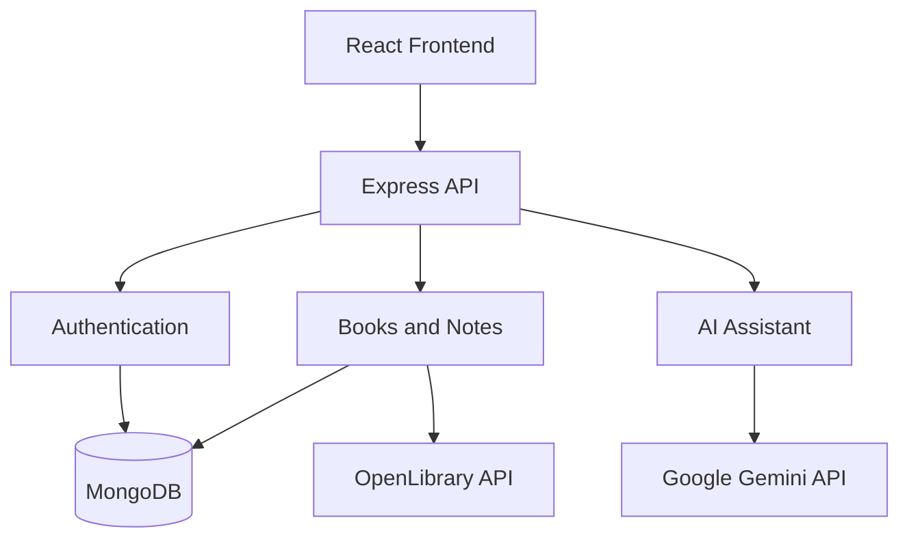

# BookMind AI 📚

BookMind AI is a reading management application built with the MERN stack and Google Gemini AI. It helps users organize their books, track reading progress, write notes, and get AI-powered assistance while reading.

**Live Demo:** [BookMind AI](https://book-m-ind-ai.vercel.app)

**GitHub Repository:** [BookMind AI](https://github.com/sainidivyansh2517/BookMInd-AI)

## Features

- **Personal Library:** Search for books and manage your reading list.
- **Reading Progress:** Track pages read, reading status, and personal reading goals.
- **Notes:** Create, edit, and delete notes related to books.
- **AI Assistant:** Ask questions and get help with book-related topics using Google Gemini.
- **Book Recommendations:** Explore book suggestions through the application's recommendation feature.
- **User Authentication:** Register and log in to maintain a personal library.
- **Responsive Interface:** Access the application through a desktop or mobile browser.

## Tech Stack

| Part | Technologies |
|---|---|
| Frontend | React, Vite, React Router |
| Styling | CSS |
| Backend | Node.js, Express.js |
| Database | MongoDB, Mongoose |
| Authentication | JWT, bcryptjs |
| AI Integration | Google Gemini API |
| Book Search | OpenLibrary API |
| Testing | Node.js Test Runner, Supertest |

## How It Works

The application uses React for the user interface and an Express API for handling requests. The backend manages authentication, books, notes, and AI-related operations. MongoDB stores application data, while OpenLibrary provides book search information and Google Gemini powers the AI assistant.



## Project Structure

```text
BookMind-AI/
├── client/
│   └── src/
│       ├── components/
│       ├── context/
│       ├── pages/
│       └── App.jsx
├── server/
│   ├── src/
│   │   ├── config/
│   │   ├── controllers/
│   │   ├── middleware/
│   │   ├── models/
│   │   ├── routes/
│   │   └── services/
│   └── tests/
├── docs/
│   ├── ARCHITECTURE.md
│   ├── API.md
│   └── DEMO_SCRIPT.md
├── package.json
└── README.md
```

## Getting Started

### Prerequisites

Install the following before running the project:

- Node.js and npm
- MongoDB, either locally or through MongoDB Atlas
- A Google Gemini API key if you want to use the live AI service

### 1. Clone the Repository

```bash
git clone https://github.com/sainidivyansh2517/BookMInd-AI.git
cd BookMInd-AI
```

### 2. Install Dependencies

```bash
npm run install:all
```

If this command is not available in your current version of the project, install the dependencies separately in the root, `client`, and `server` folders as required by their respective `package.json` files.

### 3. Configure Environment Variables

Create a local backend environment file using the example configuration:

```bash
cp server/.env.example server/.env
```

On Windows PowerShell, you can use:

```powershell
Copy-Item server/.env.example server/.env
```

Configure the required values in `server/.env`. For example:

```env
PORT=5000
NODE_ENV=development
STORAGE_MODE=mongodb
MONGO_URI=your_mongodb_connection_string
JWT_SECRET=your_private_random_secret
GEMINI_API_KEY=your_gemini_api_key
GEMINI_MODEL=your_supported_gemini_model
CLIENT_URL=http://localhost:3000
```

Use the environment variable names expected by your current configuration. Never commit real credentials to GitHub.

For frontend configuration, check `client/.env.example`. In development, the application may use the Vite proxy, so a separate API URL may not be required.

### 4. Start the Backend

Open a terminal in the project root and run:

```bash
npm run dev:server
```

### 5. Start the Frontend

Open another terminal in the project root and run:

```bash
npm run dev:client
```

Open [http://localhost:3000](http://localhost:3000) in your browser if that is the port shown by Vite.

## Testing

The project includes backend tests for authentication, input validation, book and note ownership, AI fallback behavior, and API health endpoints.

Run the backend test suite:

```bash
npm test
```

Build the frontend for production:

```bash
npm run build:client
```

The test suite passed 33 tests in my latest local verification before the account-switching changes. Run the commands again after any further changes to confirm the current results.

## API Overview

The backend provides API routes for:

- Authentication and user profiles
- Book search and personal library management
- Reading progress
- Notes management
- AI chat and recommendations
- Health and readiness checks

For endpoint details and request formats, see [API Documentation](docs/API.md).

For the application architecture, see [Architecture Documentation](docs/ARCHITECTURE.md).

## Future Improvements

Some areas that could be improved further include:

- Adding more integration and end-to-end tests
- Improving AI responses using a user's saved notes and reading history
- Adding reading analytics and progress visualizations
- Improving error reporting and application monitoring
- Refining the mobile experience

## License

Check the repository for the project's license information before reusing or distributing the code.
