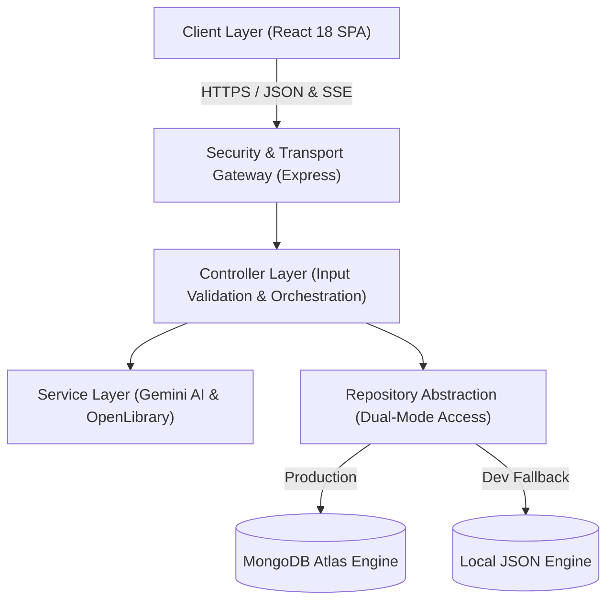
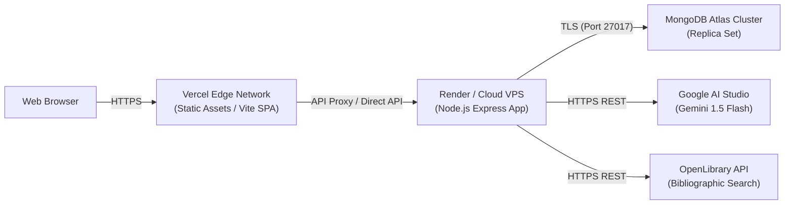

# 🏛️ BookMind AI — Architectural Documentation

This document outlines the system architecture, component lifecycles, data contracts, and security boundaries implemented in **BookMind AI**.

---

## 1. High-Level Architectural Pattern

BookMind AI is engineered following a **Layered Service-Oriented Model-View-Controller (MVC) Architecture** with an abstracted **Repository Pattern** for multi-engine data access.



### Core Architectural Layers:
1. **Presentation Layer (`client/src`)**:
   - Single-Page Application (SPA) built with React 18 and Vite.
   - Route code-splitting with `React.lazy` and `Suspense` for minimal initial bundle size.
   - Declarative data fetching, cache synchronization, and background revalidation via `@tanstack/react-query`.
   - Context-driven state management for authentication (`AuthContext`), appearance theming (`ThemeContext`), and transient feedback (`ToastContext`).
2. **Gateway & Security Layer (`server/src/index.js` & `middleware/`)**:
   - HTTP security headers provided by `helmet`.
   - Explicit CORS policy based on configured `CLIENT_URL` origins with non-browser request tolerance.
   - Granular rate limiting on sensitive authentication (`/api/auth`) and compute-heavy AI (`/api/ai`) endpoints.
   - Bearer token parsing and cryptographic JWT signature validation.
3. **Controller & Business Layer (`server/src/controllers/`)**:
   - RFC email normalization, parameter sanitization, and ownership assertion.
   - Prevents mass assignment of sensitive entity attributes.
   - Transforms and structures domain data into standardized JSON responses.
4. **Service Integration Layer (`server/src/services/`)**:
   - **`GeminiService`**: Manages Google Generative AI integration, bounded exponential backoff with jitter, model failover, and deterministic offline synthesis.
   - **`OpenLibraryService`**: Interfaces with the external OpenLibrary Search & Covers APIs with timeouts and graceful error handling.
5. **Persistence & Repository Layer (`server/src/models/` & `config/`)**:
   - Abstract repository pattern (`UserRepo`, `BookRepo`, `NoteRepo`, `ChatRepo`, `RecommendationRepo`).
   - Translates business operations into MongoDB Mongoose operations or development-only JSON file store operations.

---

## 2. Authentication & Authorization Lifecycle

```mermaid
sequenceDiagram
    autonumber
    actor User as User Browser
    participant Auth as Auth Controller
    participant DB as User Repository
    participant Mid as Auth Middleware
    participant API as Protected Route (/api/books)

    User->>Auth: POST /api/auth/login (email, password)
    Auth->>Auth: Normalize email (.toLowerCase().trim())
    Auth->>DB: findByEmail(normalizedEmail)
    DB-->>Auth: User record (with passwordHash)
    Auth->>Auth: bcrypt.compare(password, passwordHash)
    alt Invalid Credentials
        Auth-->>User: 401 Unauthorized ("Invalid email or password.")
    else Valid Credentials
        Auth->>Auth: jwt.sign({ id, email }, JWT_SECRET, { expiresIn: '7d' })
        Auth-->>User: 200 OK (token, user object excluding passwordHash)
    end

    User->>API: GET /api/books (Header: Authorization: Bearer <token>)
    API->>Mid: Intercept request
    Mid->>Mid: jwt.verify(token, JWT_SECRET)
    alt Expired / Invalid Token
        Mid-->>User: 401 Unauthorized
    else Valid Token
        Mid->>API: Attach req.user = decoded; next()
        API->>DB: findByUser(req.user.id)
        DB-->>API: Filtered user books
        API-->>User: 200 OK ({ books: [...] })
    end
```

### Storage Trade-offs: LocalStorage vs. HttpOnly Cookies
BookMind AI currently stores the Bearer JWT in `localStorage` for maximum compatibility across decoupled cross-domain frontend and backend deployments (e.g., Vercel frontend talking to Render backend across distinct root domains).

| Approach | Advantages | Security Trade-offs & Mitigations |
| :--- | :--- | :--- |
| **Current: Bearer Token in `localStorage`** | • Immune to Cross-Site Request Forgery (CSRF).<br>• Seamless across decoupled subdomains and mobile wrappers.<br>• Works cleanly with standard SSE streaming `fetch()`. | **Trade-off:** Vulnerable if an XSS vulnerability exists.<br>**Mitigation:** Strict input sanitization, zero raw `eval()`, React's automated HTML escaping, and Helmet CSP policies. |
| **Alternative: HttpOnly Secure Cookies** | • JavaScript cannot read the token, mitigating token theft via XSS. | **Trade-off:** Susceptible to CSRF without Anti-CSRF tokens; strict `SameSite=None; Secure` configuration required for cross-domain deployments, which can be blocked by Safari ITP / third-party cookie restrictions. |

---

## 3. Database Models & Schema Design

### 1. `User` Schema
```javascript
{
  name: { type: String, required: true, trim: true },
  email: { type: String, required: true, unique: true, lowercase: true, trim: true },
  passwordHash: { type: String, required: true },
  readingGoal: { type: Number, default: 24, min: 1, max: 1000 },
  favoriteGenres: [{ type: String }],
  avatar: { type: String, default: '' },
  createdAt: { type: Date, default: Date.now }
}
```

### 2. `Book` Schema & Compound Indexes
```javascript
{
  userId: { type: String, required: true, index: true },
  openLibraryId: { type: String, default: '' },
  title: { type: String, required: true },
  authors: [{ type: String }],
  coverUrl: { type: String, default: '' },
  publishYear: { type: Number },
  totalPages: { type: Number, default: 250 },
  progressPages: { type: Number, default: 0 },
  status: { type: String, enum: ['want_to_read', 'currently_reading', 'completed'], default: 'want_to_read' },
  rating: { type: Number, default: 0, min: 0, max: 5 },
  review: { type: String, default: '' },
  genres: [{ type: String }],
  description: { type: String, default: '' },
  addedAt: { type: Date, default: Date.now },
  completedAt: { type: Date }
}
```
**Indexes**:
- `{ userId: 1, status: 1 }`: Fast library filtering by reading status.
- `{ userId: 1, addedAt: -1 }`: Default reverse-chronological sorting.
- `{ userId: 1, rating: -1 }`: High-rating sorting.

### 3. `Note` Schema & Compound Indexes
```javascript
{
  userId: { type: String, required: true, index: true },
  bookId: { type: String, default: null, index: true },
  title: { type: String, required: true, trim: true },
  content: { type: String, required: true },
  tags: [{ type: String, trim: true }],
  createdAt: { type: Date, default: Date.now },
  updatedAt: { type: Date, default: Date.now }
}
```
**Indexes**:
- `{ userId: 1, updatedAt: -1 }`: Fast recency sorting.
- `{ userId: 1, bookId: 1 }`: Scoped note retrieval per book.
- `{ userId: 1, tags: 1 }`: Tag filtering across personal knowledge base.

### 4. `Recommendation` Schema (with MongoDB TTL Index)
```javascript
{
  userId: { type: String, required: true, unique: true },
  recommendations: [{
    title: { type: String, required: true },
    author: { type: String, required: true },
    genre: { type: String, default: 'Recommended' },
    reason: { type: String, required: true }
  }],
  generatedAt: { type: Date, default: Date.now },
  expiresAt: { type: Date, required: true }
}
```
**TTL Index**:
- `{ expiresAt: 1 }, { expireAfterSeconds: 0 }`: MongoDB automatically purges expired recommendation records after 12 hours without requiring background cron scripts.

---

## 4. AI Request Lifecycle & Failover Pipeline

1. **Context Harvesting**:
   - When a user asks an AI query, BookMind extracts:
     - The authenticated user's ID (`req.user.id`).
     - Book-specific metadata (if `bookId` is supplied, verifying ownership).
     - Up to 10 user-scoped notes linked to that book or general knowledge.
     - Recent library history (reading status and titles).
     - Recent conversation messages (up to 6 messages) for multi-turn conversational memory.
2. **Prompt Composition**:
   - System instructions establish BookMind AI's persona as an intelligent, concise reading assistant.
   - User notes and book details are formatted into markdown context blocks.
3. **Execution & Streaming**:
   - The server initiates SSE streaming (`text/event-stream`).
   - Tokens stream back in real-time (`data: { chunk: "..." }`).
4. **Resilience & Fallback Engine**:
   - If Google Gemini returns `429 (Resource Exhausted)` or `503 (Unavailable)`, the service retries up to 2 times with exponential backoff and randomized jitter (`1000ms * attempt + random`).
   - If failover exhausts or credentials are invalid, the **Offline Synthesis Engine** generates a deterministic markdown synthesis grounded in the user's saved notes.
   - The response includes a transparent disclosure notice: `> Note: Response generated by BookMind Offline Synthesis Engine`.

---

## 5. Deployment Topology


